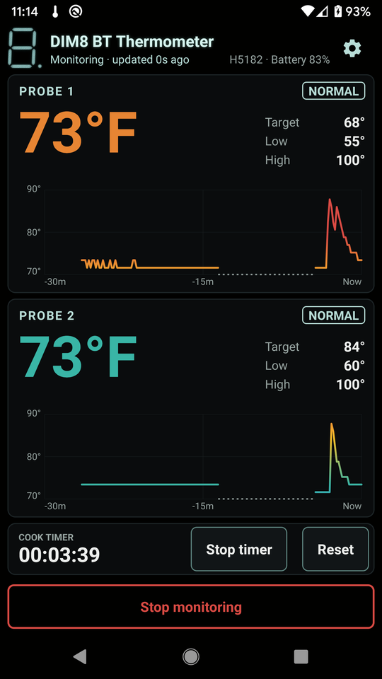

# DIM8 BT Thermometer

**A lightweight, offline Android app for monitoring Bluetooth cooking thermometers.**
Developed by **Dimension Eight Labs LLC**.



*The v1.0.0 release running on a Google Pixel XL with a Govee H5182.*

Most thermometer apps want more from you than a temperature reading. DIM8 BT Thermometer is a simple, dependable alternative: open it, start monitoring, and see your probes. It needs no account, subscription, cloud service, or Internet access, and the app does not request Android's Internet permission.

Its first supported thermometer is the **Govee H5182** dual-probe model.

> DIM8 BT Thermometer is developed independently. It is not affiliated with, sponsored by, or endorsed by Govee. "Govee" and "H5182" are used only to identify compatible hardware.

## Features

**Monitoring**

- Live temperatures from both probes, in °F or °C
- Bluetooth signal-loss monitoring with automatic recovery
- Missing-probe detection
- Per-probe **In Use / Not in Use** controls, so an unused probe stays quiet
- Elapsed cooking timer
- Settings, cook timer, and recent history stored locally on the phone

**Alarms**

- Independent high and low alarms for each probe
- Audible alerts for temperature limits, missing probes, and signal loss
- A lock-screen alarm page with a direct **Silence** button for each active alarm
- Recovery handling that clears alarms when conditions return to normal
- Silenced missing-probe and signal-loss alarms sound again every 5 minutes until resolved

**Display**

- Configurable target temperature for each probe
- Temperature-responsive colors centered on your target
- Compact 30-minute history graph for each probe
- Subtle grid with temperature and time references
- Colorful plot lines with red high and blue low markers where readings crossed a limit
- Status shown in words as well as color

## Compatibility

| | Verified |
|---|---|
| Phone | Google Pixel XL |
| Operating system | Android 10 (API 29) |
| Thermometer | Govee H5182 |

The app's minimum and target Android API level are both **29**. It may install on newer Android versions, but only the configuration above has been tested. Other thermometer models are not supported yet.

## Installation

Signed APKs will be available from the [Releases page](https://github.com/Dimension-Eight-Labs/dim8-bt-thermometer/releases) once published. Until then, you can [build from source](#building-from-source).

1. Download the signed APK to your phone, or to a computer with [ADB](https://developer.android.com/tools/adb).
2. Install it by opening the file and allowing your browser or file manager to install unknown apps, or run:

   ```sh
   adb install dim8-bt-thermometer-v1.0.0.apk
   ```

3. Open **DIM8 BT Thermometer** and tap **Start monitoring**.
4. Allow location access. Android 10 requires it for Bluetooth scanning. The app does not use it to record or share your location.
5. Tap **Select** and choose your H5182.
6. Open Settings to set targets and alarm limits. Alarms are off until you set them.

Before relying on an alarm, confirm that your phone's **alarm volume** is audible.

To verify an official release, compare its signing certificate SHA-256 fingerprint:

```text
E7:56:C6:43:BF:1F:F2:57:80:02:BF:14:E3:D4:37:B4:63:F1:2D:7F:FD:38:55:5D:76:35:99:86:44:6F:44:04
```

## Building from source

**Requirements**

- JDK 21 (verified). The project compiles to Java 17 bytecode.
- Android SDK Platform 37 and Android SDK Build-Tools 36.0.0
- The included Gradle wrapper (Gradle 9.9.2), so no separate Gradle installation is needed

Point the build at your SDK with `ANDROID_HOME` or a `local.properties` file containing `sdk.dir=/path/to/Android/Sdk`.

```sh
git clone https://github.com/Dimension-Eight-Labs/dim8-bt-thermometer.git
cd dim8-bt-thermometer

./gradlew testDebugUnitTest    # Run the unit tests
./gradlew lintDebug            # Run Android lint
./gradlew assembleDebug        # Build a debug APK
```

The debug APK is written to `app/build/outputs/apk/debug/app-debug.apk`.

### Release signing

The official signing key is private and is never included in this repository. Without signing details, `./gradlew assembleRelease` produces an **unsigned** APK at `app/build/outputs/apk/release/app-release-unsigned.apk`.

To sign your own build, create a keystore and a properties file outside the repository:

```properties
storeFile=/absolute/path/to/your-release-key.p12
storePassword=your-password
keyAlias=your-key-alias
keyPassword=your-password
```

Save it as `~/.config/dim8-bt-thermometer/signing.properties`, or set `DIM8_BT_THERMOMETER_SIGNING` to its path. `tools/create_release_key.sh` can create both files and will not replace an existing key.

If you distribute a modified build, please use your own key and application ID, and see [BRANDING.md](BRANDING.md).

## Project status

**v1.0.0 is the initial release.** It has been used and tested on real hardware, but it has not yet been proven for long unattended cooks.

**Tested on the Pixel XL and H5182 during development:** probe readings and identity, high and low alarms, Silence, the lock-screen alarm page, missing-probe alarms and recovery, signal-loss alarms and reconnection, In Use controls, and the cook timer.

**Checked on the signed v1.0.0 build:** installation, fresh settings, H5182 discovery, valid readings from both probes, and a short monitoring session.

**Automated:** host unit tests cover decoding, alarm logic, freshness, the timer, history, and display logic. There are no Android instrumentation tests.

**Still to validate:**

- Long locked-screen runs, Doze, and battery use
- Phone reboot behavior
- Bluetooth-off and permission recovery
- Do Not Disturb and alarm audibility in real cooking environments
- Running alongside the Govee app

**Known limitations**

- The H5182 reports whole °C values, so Fahrenheit readings move in steps of about 1.8 °F.
- While a probe is being unplugged, the H5182 can briefly report a low but valid-looking temperature, which can raise a low alarm.
- Alarm limits are stored in this app and are not written to the thermometer.
- Monitoring does not start automatically after a reboot.

Please don't use this app as your only safeguard for food safety. Check food with a trusted thermometer.

## Future development

These are ideas, not current features:

- Support for additional Govee and non-Govee BLE thermometers
- A local-network web dashboard for an iPhone or other browser
- An optional Bluetooth-to-network gateway

## Documentation

- [Architecture and H5182 protocol notes](docs/ARCHITECTURE.md)
- [Interface design](docs/DESIGN.md)
- [Third-party notices](THIRD_PARTY_NOTICES.md)
- [Branding policy](BRANDING.md)

## Acknowledgments

The H5182 protocol work was informed by public research from [GoveeBTTempLogger](https://github.com/wcbonner/GoveeBTTempLogger) by William C. Bonner, [govee-ble](https://github.com/Bluetooth-Devices/govee-ble) by Bluetooth-Devices, and [GoveeBT-Python](https://github.com/TechnoSwiss/GoveeBT-Python) by TechnoSwiss. The decoder in this app was written independently. See [THIRD_PARTY_NOTICES.md](THIRD_PARTY_NOTICES.md) for details.

## License

Copyright © 2026 Dimension Eight Labs LLC

SPDX-License-Identifier: `GPL-3.0-only`

This program is free software: you can redistribute it and/or modify it under the terms of the GNU General Public License as published by the Free Software Foundation, version 3.

This program is distributed in the hope that it will be useful, but WITHOUT ANY WARRANTY; without even the implied warranty of MERCHANTABILITY or FITNESS FOR A PARTICULAR PURPOSE. See the [GNU General Public License](LICENSE) for more details.

The DIM8 names and logos identify Dimension Eight Labs LLC. The GPL does not grant trademark rights. See [BRANDING.md](BRANDING.md), which also states the additional terms under GPLv3 section 7. Third-party components remain under their own licenses, listed in [THIRD_PARTY_NOTICES.md](THIRD_PARTY_NOTICES.md).
